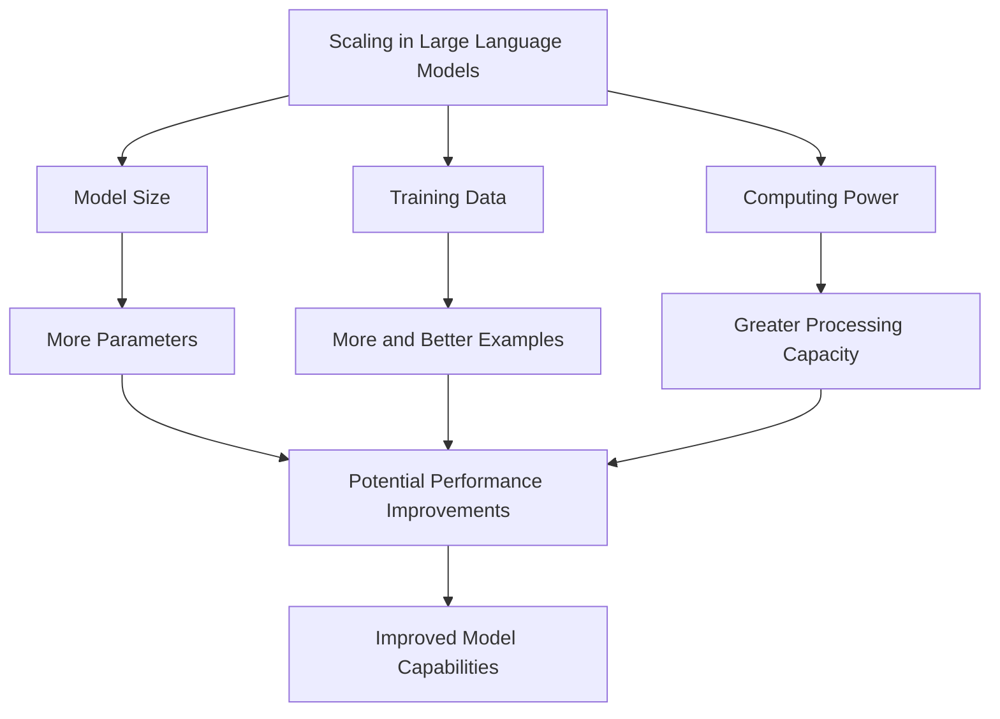
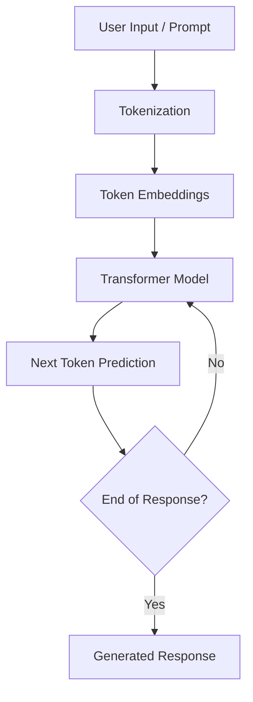
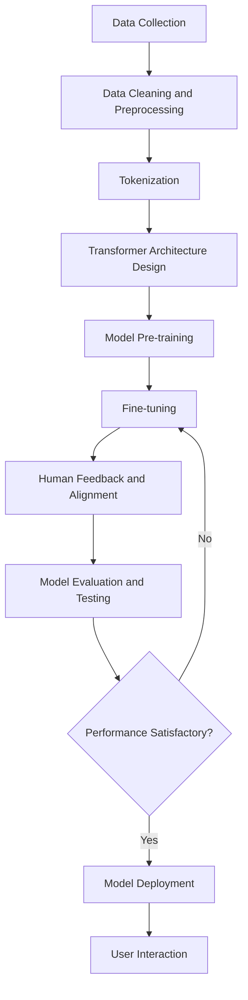

# AIM:	Comprehensive Report on the Fundamentals of Generative AI and Large Language Models (LLMs)
Experiment:
Develop a comprehensive report for the following exercises:
1.	Explain the foundational concepts of Generative AI. 
2.	Focusing on Generative AI architectures. (like transformers).
3.	Generative AI applications.
4.	Generative AI impact of scaling in LLMs.

# ALGORITHM:

**Step 1: Define Scope and Objectives**  
1.1 Identify the goal of the report (e.g., educational, research, tech overview)  
1.2 Set the target audience level (e.g., students, professionals)  
1.3 Draft a list of core topics to cover  

**Step 2: Create Report Skeleton/Structure**  
2.1 Title Page  
2.2 Abstract or Executive Summary  
2.3 Table of Contents  
2.4 Introduction  
2.5 Main Body Sections:  
- Introduction to AI and Machine Learning  
- What is Generative AI?  
- Types of Generative AI Models (e.g., GANs, VAEs, Diffusion Models)  
- Introduction to Large Language Models (LLMs)  
- Architecture of LLMs (e.g., Transformer, GPT, BERT)  
- Training Process and Data Requirements  
- Use Cases and Applications (Chatbots, Content Generation, etc.)  
- Limitations and Ethical Considerations  
- Future Trends  
2.6 Conclusion  
2.7 References  

**Step 3: Research and Data Collection**  
3.1 Gather recent academic papers, blog posts, and official docs (e.g., OpenAI, Google AI)  
3.2 Extract definitions, explanations, diagrams, and examples  
3.3 Cite all sources properly  

**Step 4: Content Development**  
4.1 Write each section in clear, simple language  
4.2 Include diagrams, figures, and charts where needed  
4.3 Highlight important terms and definitions  
4.4 Use examples and real-world analogies for better understanding  

**Step 5: Visual and Technical Enhancement**  
5.1 Add tables, comparison charts (e.g., GPT-3 vs GPT-4)  
5.2 Use tools like Canva, PowerPoint, or LaTeX for formatting  
5.3 Add code snippets or pseudocode for LLM working (optional)  

**Step 6: Review and Edit**  
6.1 Proofread for grammar, spelling, and clarity  
6.2 Ensure logical flow and consistency  
6.3 Validate technical accuracy  
6.4 Peer-review or use tools like Grammarly or ChatGPT for suggestions  

**Step 7: Finalize and Export**  
7.1 Format the report professionally  
7.2 Export as PDF or desired format  
7.3 Prepare a brief presentation if required (optional)

# OUTPUT

# QUESTION 1: EXPLAIN THE FOUNDATIONAL CONCEPTS OF GENERATIVE AI

## 1.1 Introduction to Artificial Intelligence

Artificial Intelligence (AI) is a branch of computer science that focuses on developing machines and computer systems that can perform tasks that normally require human intelligence.

These tasks include learning, reasoning, problem-solving, understanding languages, recognizing images and making decisions.

AI is used in many everyday applications, such as voice assistants, recommendation systems, facial recognition and self-driving vehicles.

### Relationship Between AI, ML and Deep Learning

Artificial Intelligence is a broad field that includes Machine Learning and Deep Learning.

- **Artificial Intelligence:** Enables machines to perform intelligent tasks.
- **Machine Learning:** Allows machines to learn patterns from data and improve their performance.
- **Deep Learning:** Uses multi-layered neural networks to learn complex patterns from large datasets.

## 1.2 What is Generative AI?

Generative Artificial Intelligence is a type of AI that creates new content by learning patterns and relationships from existing data.

It can generate different forms of content, including:

- Text and articles.
- Images and digital artwork.
- Audio and music.
- Videos and animations.
- Computer programs and code.

Unlike traditional AI systems that mainly classify or predict information, Generative AI produces new outputs based on user instructions called prompts.

**Example:** When a user enters the prompt "Write a short story about a robot", a Generative AI tool can create an original story based on that instruction.

## 1.3 How Generative AI Works

Generative AI learns from large amounts of existing data and uses the learned patterns to generate new content.

### Working Process

1. **Data Collection:** The system collects large datasets containing text, images, audio or other information.
2. **Data Preprocessing:** Unnecessary information, duplicates and errors are removed.
3. **Model Training:** The AI model learns patterns and relationships from the processed data.
4. **User Prompt:** The user provides an instruction or question.
5. **Content Generation:** The trained model processes the prompt and generates suitable content.
6. **Output:** The generated result is presented to the user.

## 1.4 Types of Generative AI

## 1.5 Features of Generative AI

1. **Content Creation:** Generates new text, images, audio and videos.
2. **Natural Language Processing:** Understands and responds to human-language instructions.
3. **Automation:** Automates repetitive writing and content-related tasks.
4. **Adaptability:** Can perform different tasks using suitable prompts.
5. **Personalization:** Can adjust responses according to user requirements.
6. **Multimodal Capabilities:** Some models can process multiple types of information, such as text, images and audio.

## 1.6 Advantages of Generative AI

- Saves time and improves productivity.
- Supports creative content generation.
- Helps students understand difficult concepts.
- Assists programmers in writing and debugging code.
- Automates repetitive tasks.
- Provides personalized learning experiences.
- Supports research and innovation.

## 1.7 Limitations of Generative AI

- May generate incorrect or misleading information.
- Requires large amounts of training data.
- Needs significant computing resources.
- May produce biased outputs.
- Can create privacy and copyright concerns.
- May be misused to generate fake images, videos and information.

## 1.8 Generative AI vs Traditional AI

### Real-World Applications

**Education:** Generates study notes, explanations, summaries and practice questions.

**Healthcare:** Assists with medical research, documentation and synthetic data generation.

**Software Development:** Helps programmers generate code, identify errors and understand programming concepts.

**Entertainment:** Creates digital artwork, music, animations and videos.

**Business:** Generates advertisements, product descriptions and customer support responses.

## 1.9 Conclusion

Generative AI is an important development in Artificial Intelligence that enables machines to create new content using patterns learned from existing data. It has applications in education, healthcare, entertainment, business and software development. Although it improves productivity and creativity, issues such as incorrect information, bias, privacy and copyright must be addressed.

---

# QUESTION 2: EXPLAIN THE MAJOR ARCHITECTURES USED IN GENERATIVE AI

## 2.1 Introduction

Generative AI uses different deep learning architectures to learn patterns from data and generate new content.

An architecture refers to the structure and organization of a neural network that determines how information is processed.

The four major architectures are:

1. Transformers.
2. Generative Adversarial Networks (GANs).
3. Variational Autoencoders (VAEs).
4. Diffusion Models.

## 2.2 Transformer Architecture

### Definition

Transformers are deep learning architectures widely used in modern Natural Language Processing and Generative AI.

They were introduced in the research paper *Attention Is All You Need* in 2017.

Transformers use a mechanism called Self-Attention to understand the relationships between different words in a sentence.

### Main Components

1. **Input Embedding:** Converts input tokens into numerical representations.
2. **Positional Encoding:** Provides information about the position of each token.
3. **Self-Attention:** Identifies relationships between tokens.
4. **Multi-Head Attention:** Allows the model to examine different relationships simultaneously.
5. **Feed Forward Network:** Processes the information obtained from the attention mechanism.
6. **Output Layer:** Produces the required output.

### Working Process

1. Input text is divided into tokens.
2. Tokens are converted into numerical embeddings.
3. Positional information is added.
4. The self-attention mechanism identifies relationships between tokens.
5. Neural network layers process the information.
6. The model generates the required output.

### Transformer Architecture Diagram

### Advantages

- Understands relationships between words effectively.
- Handles large amounts of text.
- Supports parallel processing during training.
- Performs well in language-related tasks.
- Forms the foundation of modern LLMs.

### Limitations

- Requires large training datasets.
- Needs significant computing resources.
- Attention computation can become expensive for long sequences.
- May generate incorrect information.

### Applications

- Chatbots.
- Language translation.
- Text summarization.
- Code generation.
- Question answering.

**Example:** ChatGPT uses Transformer-based GPT models to generate human-like text.

## 2.3 Generative Adversarial Networks (GANs)

### Definition

Generative Adversarial Networks are generative models introduced by Ian Goodfellow and his research team in 2014.

GANs consist of two neural networks called the Generator and Discriminator. These networks compete with each other to produce realistic data.

### Main Components

**1. Generator**

The Generator creates artificial data, such as images, using random input.

**2. Discriminator**

The Discriminator examines the generated data and tries to identify whether it is real or fake.

### Working Process

1. The Generator receives random noise as input.
2. It produces fake images or other data.
3. The Discriminator receives both real and generated data.
4. It predicts whether the data is real or fake.
5. Feedback is provided to improve both networks.
6. The Generator gradually learns to create more realistic outputs.

### GAN Architecture Diagram

### Advantages

- Generates realistic images.
- Produces synthetic training data.
- Useful for image enhancement.
- Supports creative applications.

### Limitations

- Training can be unstable.
- May produce repetitive outputs, known as mode collapse.
- Requires careful selection of training parameters.
- Difficult to train compared with some other architectures.

### Applications

- Human face generation.
- Image enhancement.
- Image-to-image translation.
- Video game graphics.
- Synthetic data generation.

**Example:** A GAN can generate artificial human faces that do not belong to real people.

## 2.4 Variational Autoencoders (VAEs)

### Definition

Variational Autoencoders are generative models that learn compressed representations of data and use those representations to generate new similar data.

They are based on an encoder-decoder architecture.

### Main Components

**1. Encoder**

The Encoder receives the input data and converts it into a compressed probability distribution.

**2. Latent Space**

Latent Space is a smaller mathematical representation that captures important features of the original data.

**3. Decoder**

The Decoder uses the latent representation to reconstruct the original data or generate new similar data.

### Working Process

1. Input data is provided to the Encoder.
2. The Encoder extracts important features.
3. The features are represented in a latent space.
4. A sample is selected from the learned distribution.
5. The Decoder reconstructs or generates new data.

### VAE Architecture Diagram

### Advantages

- Learns meaningful data representations.
- Generates new data similar to the training data.
- Provides a structured latent space.
- Useful for data reconstruction and anomaly detection.

### Limitations

- Generated images may appear blurry.
- Requires careful training.
- May produce less detailed outputs than some other image-generation approaches.

### Applications

- Image generation.
- Data compression.
- Anomaly detection.
- Medical image analysis.
- Synthetic data generation.

**Example:** A VAE can learn the features of human faces and generate new faces using different combinations of learned features.

## 2.5 Diffusion Models

### Definition

Diffusion Models are generative models that create new content by learning to gradually remove noise from randomly generated data.

They are widely used in modern image-generation systems.

### Main Components

**1. Forward Diffusion Process**

Gradually adds noise to the original training data until it becomes almost completely noisy.

**2. Noise Prediction Network**

Learns to predict the noise added to the data.

**3. Reverse Diffusion Process**

Gradually removes noise to generate a meaningful output.

### Working Process

1. An original image is selected during training.
2. Noise is gradually added to the image.
3. The model learns to predict the added noise.
4. During generation, random noise is provided as input.
5. The model gradually removes the noise.
6. A meaningful image is generated.

### Diffusion Model Diagram

### Advantages

- Produces high-quality images.
- Generates detailed and creative content.
- Supports text-to-image generation.
- Provides stable training compared with adversarial training approaches.

### Limitations

- Can require many denoising steps.
- Generation may take time.
- Requires significant computing resources.
- Depends on suitable training data.

### Applications

- Digital artwork.
- Image restoration.
- Text-to-image generation.
- Video generation.
- Creative design.

**Example:** When a user enters "A beautiful house near a mountain", a diffusion model can gradually transform random noise into an image matching the description.

## 2.6 Comparison of Major Generative AI Architectures

| Feature | Transformer | GAN | VAE | Diffusion |
|---|---|---|---|---|
| Main Mechanism | Self-attention | Generator and Discriminator | Encoder and Decoder | Noise removal |
| Main Use | Text generation | Realistic data generation | Data representation and generation | Image generation |
| Training | Sequence learning | Adversarial training | Probabilistic learning | Denoising learning |
| Main Advantage | Understands context | Realistic outputs | Structured latent space | Detailed outputs |
| Limitation | High computational cost | Unstable training | Can produce blurry outputs | Slower generation |

## 2.7 Conclusion

Transformers, GANs, VAEs and Diffusion Models are important architectures in Generative AI. Transformers are widely used for language generation, GANs generate realistic synthetic data, VAEs learn compressed representations and Diffusion Models generate high-quality images by gradually removing noise. Each architecture has different advantages and applications.

---

# QUESTION 3: EXPLAIN GENERATIVE AI ARCHITECTURE AND ITS APPLICATIONS

## 3.1 Introduction

Generative AI architecture refers to the design and structure of the neural networks responsible for generating new content.

Different architectures are designed to handle different types of data and tasks.

For example:

- Transformers are mainly used for language and sequence generation.
- GANs are used for realistic synthetic data generation.
- VAEs are used for learning and generating similar data.
- Diffusion Models are used for high-quality image generation.

## 3.2 Applications of Transformer Architecture

Transformers are widely used in applications that require understanding and generating sequences of information.

**Applications:**

1. **Chatbots:** Generate responses to user questions.
2. **Language Translation:** Translate sentences between different languages.
3. **Text Summarization:** Convert lengthy documents into shorter summaries.
4. **Code Generation:** Generate programming code from natural-language instructions.
5. **Question Answering:** Provide answers based on the given context.

**Real-World Examples:**

- ChatGPT – Text generation and question answering.
- Gemini – Multimodal assistance and text generation.
- GitHub Copilot – Programming assistance.
- BERT-based systems – Text understanding and classification.

## 3.3 Applications of GAN Architecture

GANs are mainly used in applications that require generating realistic synthetic data.

**Applications:**

1. **Face Generation:** Creates artificial human faces.
2. **Image Enhancement:** Improves image quality and resolution.
3. **Fashion Design:** Generates creative clothing designs.
4. **Image Translation:** Converts images from one style to another.
5. **Synthetic Data:** Generates artificial datasets for research and model training.

**Example:** GANs can convert an ordinary photograph into an artistic painting using image-to-image translation techniques.

## 3.4 Applications of VAE Architecture

VAEs are useful for learning the important features of data and generating new samples.

**Applications:**

1. **Medical Research:** Generates synthetic medical data.
2. **Anomaly Detection:** Identifies unusual patterns in datasets.
3. **Data Compression:** Learns compact representations of data.
4. **Image Generation:** Generates new images using latent representations.
5. **Scientific Research:** Helps explore possible molecular structures.

**Example:** A VAE can learn patterns from a collection of images and generate new images with similar features.

## 3.5 Applications of Diffusion Models

Diffusion Models are widely used for generating detailed visual content.

**Applications:**

1. **Digital Artwork:** Creates images based on text descriptions.
2. **Image Editing:** Modifies existing images.
3. **Image Restoration:** Removes noise and improves image quality.
4. **Video Generation:** Generates video content from prompts.
5. **Creative Design:** Helps designers create visual concepts.

**Real-World Examples:**

- DALL-E – Text-to-image generation.
- Stable Diffusion – Image generation and editing.
- Midjourney – AI-assisted digital artwork.
- Sora – Video generation.

## 3.6 Applications Across Different Industries

| Industry | Application | Benefits |
|---|---|---|
| Education | AI tutors and personalized study materials | Supports learning |
| Healthcare | Medical research and documentation | Assists professionals |
| Banking | Customer support and document processing | Improves efficiency |
| Entertainment | Music, images and video generation | Supports creativity |
| Software | Code generation and debugging | Saves development time |
| Marketing | Advertisement and content generation | Speeds up content creation |
| Manufacturing | Design assistance and synthetic data | Supports product development |

## 3.7 Advantages of Generative AI Applications

- Reduces repetitive manual work.
- Improves productivity.
- Supports creativity and innovation.
- Helps automate content generation.
- Provides personalized assistance.
- Supports research and development.
- Makes information more accessible.

## 3.8 Challenges in Real-World Applications

Despite its benefits, Generative AI introduces several challenges.

1. Incorrect or misleading generated information.
2. Privacy and security concerns.
3. Bias in generated content.
4. Copyright and ownership issues.
5. High computational costs.
6. Potential misuse of AI-generated content.

## 3.9 Conclusion

Generative AI architectures are used in several industries to create new content and automate tasks. Transformers support language generation, GANs generate realistic synthetic data, VAEs learn structured data representations and Diffusion Models produce detailed images. Their applications continue to expand across education, healthcare, banking, entertainment and software development.

---

# QUESTION 4: EXPLAIN THE IMPACT OF SCALING IN LARGE LANGUAGE MODELS (LLMs)

## 4.1 Introduction to Large Language Models

Large Language Models are advanced AI systems trained on large amounts of text data to understand and generate human-like language.

They are capable of performing tasks such as:

- Answering questions.
- Generating articles and reports.
- Summarizing documents.
- Translating languages.
- Writing computer programs.
- Assisting with problem-solving.

Examples include GPT, Gemini, Claude and LLaMA.

## 4.2 What is Scaling in LLMs?

Scaling refers to increasing the resources and size of an AI model to improve its capabilities and performance.

It mainly involves three factors:

1. Model size.
2. Training data.
3. Computing power.

Scaling has played an important role in the development of modern LLMs.

## 4.3 Three Main Factors of Scaling

### 1. Model Size

Model size refers to the number of parameters in an AI model.

Parameters are numerical values learned during training that help the model identify patterns and relationships.

A larger number of parameters can increase the model's ability to represent complex patterns, provided that sufficient data and computing resources are available.

**Example:** A larger language model may be capable of handling more complex language-generation tasks than a smaller model, although size alone does not guarantee better performance.

### 2. Training Data

Training data refers to the information used to teach an AI model.

It may include:

- Books.
- Research papers.
- Websites.
- Articles.
- Programming code.
- Other text datasets.

High-quality and diverse training data helps models learn language patterns, facts and relationships.

**Example:** Training a model using diverse programming datasets can help it learn different programming languages and coding patterns.

### 3. Computing Power

Computing power refers to the hardware resources used to train and operate an AI model.

Common resources include:

- Graphics Processing Units (GPUs).
- Specialized AI accelerators.
- High-performance computing systems.
- Large storage systems.

More computing resources can support the training of larger models and help process larger datasets.

**Example:** GPU clusters are used to perform the large number of calculations required during LLM training.

## 4.4 Diagram: Scaling in LLMs

## 4.5 Impact of Scaling on LLM Performance

Scaling can improve the capabilities of Large Language Models in several ways.

### 1. Improved Language Understanding

Larger and well-trained models can learn more complex language patterns and relationships.

### 2. Better Content Generation

Scaling can improve the quality, fluency and relevance of generated responses.

### 3. Improved Problem-Solving

Well-trained models may perform better on mathematical, logical and analytical tasks.

### 4. Better Multilingual Capabilities

Training on diverse language datasets can help models process and generate multiple languages.

### 5. Advanced Task Performance

Scaled models can perform different tasks such as summarization, translation, coding and question answering.

## 4.6 Benefits of Scaling in LLMs

1. Better language-generation capabilities.
2. Improved performance on many complex tasks.
3. Ability to handle diverse types of prompts.
4. Improved performance across multiple domains.
5. Better support for coding and content generation.
6. Development of more advanced AI applications.

## 4.7 Challenges of Scaling in LLMs

### 1. High Training Cost

Training large models requires expensive hardware and infrastructure.

### 2. Energy Consumption

Large computing systems consume considerable amounts of electricity.

### 3. Data Requirements

Collecting, cleaning and maintaining high-quality training data is difficult.

### 4. Training Time

Large models may require extensive training time and computational resources.

### 5. Environmental Impact

Large-scale AI training can increase energy consumption and the environmental footprint of data centers.

### 6. Ethical Concerns

Larger models can still produce biased, misleading or harmful outputs.

## 4.8 Limitations of Scaling

- Increasing model size does not guarantee correct answers.
- Larger models may still produce hallucinations.
- More data does not guarantee better performance if the data is poor.
- Computing costs can become very high.
- Model performance also depends on architecture and training methods.
- Some tasks may not benefit significantly from additional model size.

## 4.9 Small LLM vs Large LLM

| Feature | Small LLM | Large LLM |
|---|---|---|
| Parameters | Generally fewer | Generally more |
| Computing Requirements | Lower | Higher |
| Training Resources | Usually lower | Usually higher |
| Response Speed | Can be faster | Depends on model and hardware |
| Complex Tasks | May have more limited capabilities | May handle more complex tasks |
| Deployment | Easier on limited hardware | May require specialized infrastructure |

## 4.10 GPT-3 vs GPT-4

GPT-3 and GPT-4 are generations of language models developed by OpenAI.

| Feature | GPT-3 | GPT-4 |
|---|---|---|
| Model Generation | Earlier generation | More advanced generation |
| Text Generation | Produces human-like text | Improved performance on many language tasks |
| Reasoning | Performs many language tasks | Improved performance on many complex tasks |
| Input Capabilities | Primarily text | Text and image inputs in supported versions |
| Applications | Content generation and question answering | Advanced assistance and multimodal tasks |

Note: This is a high-level comparison. Actual capabilities depend on the model version and configuration.

## 4.11 Real-World Applications of Scaling in LLMs

| Field | Application | How LLMs Help |
|---|---|---|
| Education | AI tutoring | Provides explanations and learning assistance |
| Healthcare | Medical documentation | Assists with summarization and information processing |
| Software Development | Code generation | Helps write and debug programs |
| Banking | Customer support | Answers customer queries |
| Business | Report generation | Summarizes documents and creates drafts |
| Communication | Language translation | Helps process different languages |

## 4.12 Future of Scaling in LLMs

Future developments are expected to focus not only on increasing model size but also on improving efficiency.

Important developments include:

- Smaller and more efficient language models.
- Better training techniques.
- Improved data quality.
- Reduced computing requirements.
- Multimodal language models.
- AI agents capable of performing multiple tasks.
- More responsible and reliable AI systems.

## 4.13 Conclusion

Scaling plays an important role in improving the performance and capabilities of Large Language Models. Increasing model size, training data and computing power can improve language generation, problem-solving and task performance.

However, scaling also introduces challenges such as high training costs, energy consumption, data requirements and ethical concerns. Therefore, future development should focus on building models that are not only powerful but also efficient, reliable and responsible.

---

# QUESTION 5: EXPLAIN LARGE LANGUAGE MODELS (LLMs) AND HOW THEY ARE BUILT

## 5.1 Introduction to Large Language Models

Large Language Models (LLMs) are advanced Artificial Intelligence models designed to understand, process and generate human-like language. They are trained using enormous amounts of text data, such as books, articles, websites, research papers and programming code.

LLMs use Deep Learning techniques and neural network architectures, particularly Transformers, to understand relationships between words and generate meaningful responses.

They can perform various tasks, including:
- Answering questions.
- Generating articles and reports.
- Summarizing long documents.
- Translating languages.
- Writing and debugging computer programs.
- Understanding and explaining complex topics.

**Examples of Large Language Models:**

| LLM | Developed By | Main Applications |
|---|---|---|
| GPT | OpenAI | Text generation, coding and question answering |
| Gemini | Google | Text generation and multimodal tasks |
| LLaMA | Meta | Research and AI applications |
| Claude | Anthropic | Writing, reasoning and document analysis |
| BERT | Google | Language understanding and text classification |

## 5.2 How Does an LLM Work?

An LLM works by learning patterns and relationships from large amounts of text data. It uses these learned patterns to predict the next token and generate meaningful responses.

The working process involves:

1. **Input:** The user enters a question or instruction called a prompt.
2. **Tokenization:** The input text is divided into smaller units called tokens.
3. **Embedding:** Tokens are converted into numerical representations.
4. **Processing:** The Transformer architecture processes the tokens using attention mechanisms.
5. **Prediction:** The model predicts the next token based on the available context.
6. **Generation:** The process continues until the complete response is generated.
7. **Output:** The generated response is displayed to the user.

### Diagram: Working of an LLM

## 5.3 How Are Large Language Models Built?

Building an LLM is a complex process that involves collecting data, designing a neural network, training the model and evaluating its performance.

The major stages involved in building an LLM are explained below.

### Step 1: Data Collection

The first step is collecting large amounts of text data from different sources.

Common data sources include:
- Books and research papers.
- Websites and online articles.
- Educational materials.
- Programming code repositories.
- Publicly available datasets.

The collected data should be diverse, relevant and of good quality.

### Step 2: Data Cleaning and Preprocessing

Raw data may contain duplicate information, spelling errors, irrelevant content and unwanted characters.

Therefore, the collected data is cleaned and processed before training.

The process includes:
- Removing duplicate content.
- Filtering irrelevant information.
- Correcting formatting issues.
- Removing unwanted or corrupted data.
- Organizing the data into suitable formats.

This step helps improve the quality of the training dataset.

### Step 3: Tokenization

Tokenization is the process of dividing text into smaller units called tokens.

A token may represent a complete word, part of a word or an individual character.

**Example:**

Input sentence:

"Artificial Intelligence is interesting."

Possible tokens:

`["Artificial", " Intelligence", " is", " interesting", "."]`

The tokens are then converted into numerical IDs so that the model can process them.

### Step 4: Model Architecture Design

After preparing the data, a suitable neural network architecture is selected.

Most modern LLMs use the Transformer architecture.

Important components include:

- **Embedding Layer:** Converts tokens into numerical vectors.
- **Positional Information:** Helps the model understand token positions.
- **Self-Attention Mechanism:** Identifies relationships between different tokens.
- **Feed Forward Network:** Processes information through neural network layers.
- **Output Layer:** Produces predictions for the next token.

The architecture is designed according to the intended purpose of the model.

### Step 5: Model Pre-training

Pre-training is the process of teaching the model general language patterns using large datasets.

For example, a model may be given the sentence:

"The sun rises in the _____."

The model learns to predict a suitable next token based on the context.

During pre-training:
- The model processes large amounts of text.
- It predicts missing or upcoming tokens.
- Its predictions are compared with the expected training targets.
- Model parameters are adjusted to reduce prediction errors.
- The process is repeated many times.

This enables the model to learn grammar, vocabulary, language patterns and relationships between words.

### Step 6: Fine-tuning

After pre-training, the model can be fine-tuned using carefully selected datasets for specific tasks.

Fine-tuning helps the model become more useful for particular applications.

Examples:
- Fine-tuning for medical information processing.
- Fine-tuning for programming assistance.
- Fine-tuning for customer support.
- Fine-tuning for educational applications.

### Step 7: Human Feedback and Alignment

Human feedback can be used to improve the quality, helpfulness and safety of an LLM.

One commonly used approach is Reinforcement Learning from Human Feedback (RLHF).

The general process involves:
1. Generating multiple responses to prompts.
2. Collecting human preferences about the responses.
3. Training a reward model to learn these preferences.
4. Using feedback-based optimization to improve model responses.

### Step 8: Model Evaluation and Testing

The trained model is evaluated to measure its performance.

Testing may include:
- Accuracy and language understanding.
- Reasoning and problem-solving.
- Response quality.
- Bias and fairness.
- Safety and reliability.
- Performance on different tasks.

If problems are identified, the model can be improved through additional training or adjustments.

### Step 9: Deployment

After training and evaluation, the model is deployed so that users can access it through applications, websites or APIs.

For example:
- ChatGPT provides an interface for interacting with GPT models.
- AI-powered applications use LLM APIs to generate responses.
- Educational platforms integrate LLMs to provide learning assistance.

## 5.4 Complete Architecture: Building an LLM

The following diagram represents the overall process of developing a Large Language Model.

## 5.5 Important Technologies Used to Build LLMs

| Technology | Purpose |
|---|---|
| Python | Programming language used in AI development |
| PyTorch | Deep Learning framework |
| TensorFlow | Machine Learning and Deep Learning framework |
| CUDA | Supports GPU-based computations |
| Hugging Face | Provides tools, models and libraries for LLM development |
| GPUs | Perform large-scale training computations |
| Transformer Architecture | Processes and understands sequences of tokens |

## 5.6 Training Requirements for LLMs

Building an LLM requires several resources.

**1. Large Datasets:** Large and diverse datasets are required to teach the model language patterns.

**2. Computing Power:** High-performance GPUs and specialized AI accelerators are used for training.

**3. Storage:** Large storage systems are needed to store datasets, model parameters and training checkpoints.

**4. Training Time:** Training large models can take considerable time depending on model size and available hardware.

**5. Skilled Developers:** Machine Learning engineers and researchers are required to design, train and evaluate the models.

## 5.7 Advantages of LLMs

- Understand and generate human-like text.
- Perform multiple language-related tasks.
- Assist in programming and debugging.
- Support education and research.
- Automate content generation.
- Improve productivity.
- Support multilingual communication.

## 5.8 Limitations of LLMs

- May generate incorrect or misleading information.
- Can produce biased responses.
- Require significant computational resources.
- Depend on the quality of training data.
- May have limited knowledge of recent events unless updated or connected to external information.
- Can raise privacy and security concerns.
- May struggle with certain complex reasoning tasks.

## 5.9 Applications of LLMs

| Domain | Applications |
|---|---|
| Education | AI tutors, explanations and study materials |
| Healthcare | Medical documentation and research assistance |
| Software Development | Code generation, debugging and explanation |
| Business | Report writing and customer support |
| Banking | Customer assistance and document processing |
| Communication | Translation, summarization and email generation |
| Research | Literature summarization and information extraction |

## 5.10 Conclusion

Large Language Models are advanced AI systems that can understand and generate human-like language. They are generally built using Transformer-based neural network architectures and trained on large amounts of text data.

The development process includes data collection, preprocessing, tokenization, architecture design, pre-training, fine-tuning, human feedback, evaluation and deployment.

LLMs have applications in education, healthcare, software development, business and many other industries. Although they offer several advantages, challenges such as hallucinations, bias, privacy and computational costs must be addressed to ensure their responsible use.

# RESULT  
The required report on Generative AI has been submitted.  
